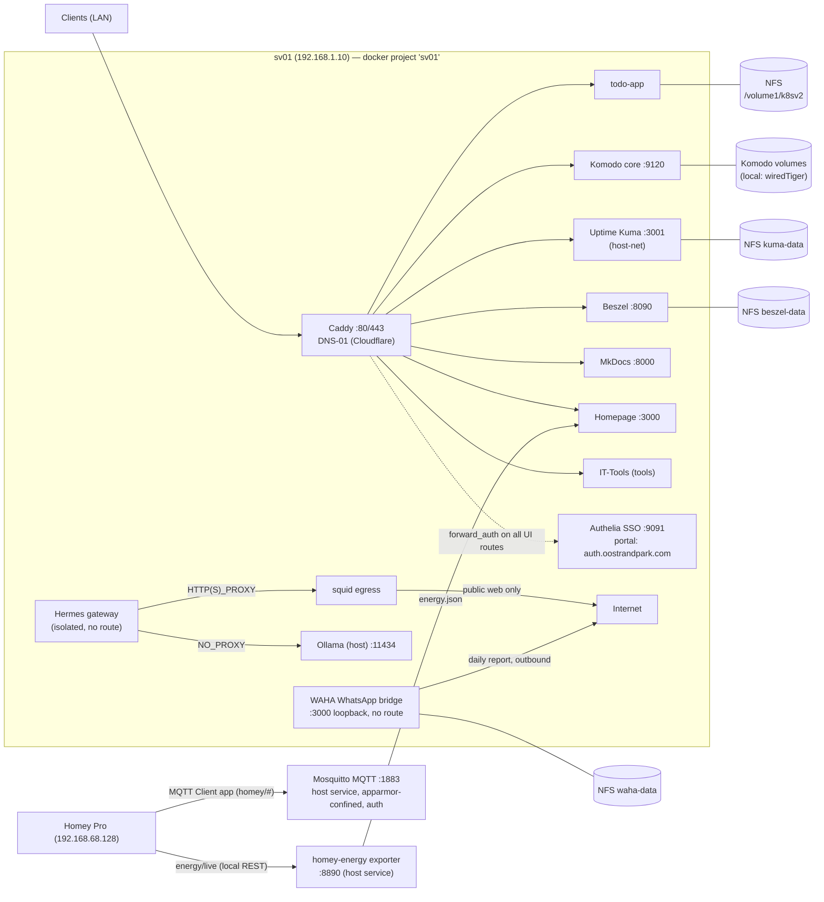

# Oostrandpark Homelab

Config-as-code for a two-host homelab, managed in [RKruit/k3s-gitops](https://github.com/RKruit/k3s-gitops).

| Host | Address | Role |
|---|---|---|
| **sv01** | 192.168.1.10 | Docker Compose stack: Caddy, todo-app, Komodo, Hermes gateway, Kuma, Beszel, Authelia SSO, WAHA WhatsApp bridge. Also runs host-side: Ollama, Hindsight, Postgres. |
| **sv02** | sv02.oostrandpark.com | Docker Compose: Mosquitto 2.0, Caddy 2.8 (`sv02-docker.service`). |

## Deploy model

```
git push ──►  <= 5 min  ──►  git pull --ff-only + docker compose up -d
```

- sv01: systemd `sv01-config-sync.timer` (every 5 min, runs as rkruit). Force: `sudo systemctl restart sv01-config-sync.service`.
- sv02: `sv02-docker.service`.
- These docs are part of the same repo (`docs/`), served at https://docs.oostrandpark.com.

## Topology



## Where to look

- [sv01](hosts/sv01.md) / [sv02](hosts/sv02.md) — machine inventories
- Service pages under **Services** — how each thing is wired and what breaks it
- **Runbooks** — deploy, expose a new hostname, Kuma API monitors, rebuild, backups
- [GitHub](infra/github.md), [Network & DNS](infra/network-dns.md), [NFS storage](infra/nfs-storage.md), [Secrets](infra/secrets.md)

## Rules of the road

1. **Secrets never in git or docs** — document file paths only ([inventory](infra/secrets.md)).
2. **Config change + docs update in the same commit.**
3. **sv02 is deliberately not monitored by Uptime Kuma** (Robert's choice) — don't add monitors for it without asking.
4. DNS is manual (Robert): new hostnames need a local unbound entry; TLS uses Cloudflare DNS-01 so no public records are needed.

<!-- okf:index:start -->
## Doc-index

Every page carries frontmatter: a `description` one-liner plus an optional `related` list (paths relative to the `docs/` root). This section is regenerated by `scripts/okf_check.py --write-index`.

### Hosts

| Page | Description |
|---|---|
| [`sv01`](hosts/sv01.md) | sv01 (192.168.1.10): container stack + host-side services — images, paths, systemd units, LAN ports, gotchas. |
| [`sv02`](hosts/sv02.md) | sv02 (sv02.oostrandpark.com): Docker Compose iteration (Mosquitto + Caddy, tls internal); the old Talos cluster is gone. |

### Services

| Page | Description |
|---|---|
| [`Caddy`](services/caddy.md) | Reverse proxy + TLS on sv01: custom cloudflare-DNS-01 image, route table, stale-mount and reload gotchas. |
| [`Uptime Kuma`](services/uptime-kuma.md) | Health checks + Telegram alerts (Kuma v2.5.7, host-net :3001): design choices, monitor set, API gotchas. |
| [`Beszel`](services/beszel.md) | Host & container metrics: hub/agent wiring, unix-socket mode, PocketBase quirks, superuser admin. |
| [`Komodo`](services/komodo.md) | Komodo (mongo/core/periphery): API automation — and why it must never deploy the sv01 stack. |
| [`todo-app`](services/todo-app.md) | Private GHCR image at todo.oostrandpark.com; NFS data continuity with the old k3s PVC dir, image update path. |
| [`Hermes + egress`](services/hermes.md) | Hermes gateway + squid egress: full isolation (no route, public-web-only proxy), host Ollama via bridge gateway. |
| [`WAHA (WhatsApp bridge)`](services/waha.md) | WAHA core bridge (NOWEB engine): loopback-only WhatsApp send API :3000 for the daily homelab report cronjob; NFS session storage, no Caddy route. |
| [`Homepage`](services/homepage.md) | gethomepage dashboard on homepage.oostrandpark.com: stateless config in git, status-dots via docker.sock, Kuma status-page widget. |
| [`IT-Tools`](services/it-tools.md) | Stateless dev/web toolbox on tools.oostrandpark.com: wiring, history (k3s → compose), Kuma monitor. |
| [`Authelia`](services/authelia.md) | SSO provider on auth.oostrandpark.com: one account behind Caddy forward_auth on every UI route, XFF-based Kuma bypass, OIDC live for Beszel. |
| [`Container-upkeep`](services/container-upkeep.md) | Automated container upkeep on sv01: daily image-update timer, autoheal (unhealthy restarts) and diun (update notifications via Telegram). |
| [`Mosquitto (MQTT)`](services/mosquitto.md) | Host-native Mosquitto MQTT broker on sv01 — LAN-only 192.168.1.10:1883, mandatory auth, AppArmor-constrained; feeds the Homey MQTT Client app and sv01-side automation. |
| [`Homey Pro`](services/homey.md) | Homey Pro hub access from sv01 — Athom OAuth client (read/control) + Homey CLI root-scope session for writes, phase-1 reorganisation result, MQTT bridge, energy exporter, remote-control recipes. |

### Runbooks

| Page | Description |
|---|---|
| [`Deploy a change`](runbooks/deploy.md) | Deploy a change: edit → push → sync unit applies; GHCR pull rule, rkruit-pull rule, verification checks. |
| [`New hostname via Caddy`](runbooks/caddy-new-site.md) | Expose a new hostname: Caddy route, explicit reload, manual unbound entry, DNS-01 timing, monitor hookup. |
| [`Add Kuma monitor (API)`](runbooks/kuma-monitor.md) | Add/update Kuma monitors via the socket.io API: venv setup, v2.5.7 payload gotchas, verification via beats and DB. |
| [`Rebuild a host`](runbooks/new-host.md) | Rebuild/bootstrap a host: idempotent sv01 bootstrap, prerequisites (free ports, restored secrets), data survival. |
| [`Backups & restore`](runbooks/backups-restore.md) | Backups & restore: honest current state (no scheduled job yet), NFS data locations, live-sqlite and per-instance-PKI cautions. |

### Infra

| Page | Description |
|---|---|
| [`GitHub`](infra/github.md) | RKuit/k3s-gitops as single source of truth: repo layout, two-clone model, credential paths, no-CI rationale. |
| [`GitHub push-deploy`](infra/webhook-deploy.md) | Push-deploy chain GitHub → CF tunnel → loopback receiver → sync unit: architecture, security, setup, pitfalls. |
| [`Network & DNS`](infra/network-dns.md) | IP-plan, DNS policy (Cloudflare zones, DNS-01, manual unbound entries), sv01 hostname table, squid isolation ranges. |
| [`NFS storage`](infra/nfs-storage.md) | NFS storage pattern (local-driver volumes + nfs4 opts), live sv01 volume mapping, safe new-subdir creation. |
| [`Secrets`](infra/secrets.md) | Secrets inventory: paths-only policy, per-host secret files and their consumers, hygiene rules. |

<!-- okf:index:end -->
