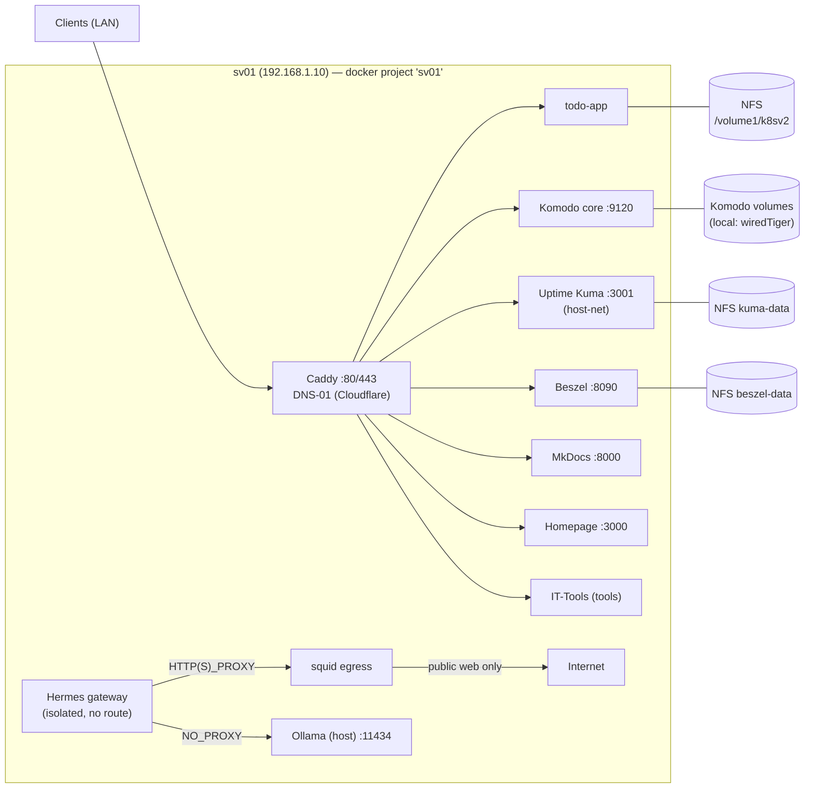

# Oostrandpark Homelab

Config-as-code for a two-host homelab, managed in [RKruit/k3s-gitops](https://github.com/RKruit/k3s-gitops).

| Host | Address | Role |
|---|---|---|
| **sv01** | 192.168.1.10 | Docker Compose stack: Caddy, todo-app, Komodo, Hermes gateway, Kuma, Beszel. Also runs host-side: Ollama, Hindsight, Postgres. |
| **sv02** | sv02.oostrandpark.com | Docker Compose: Mosquitto 2.0, Caddy 2.8 (`sv02-docker.service`). |

## Deploy model

```
git push ──►  <= 5 min  ──►  git pull --ff-only + docker compose up -d
```

- sv01: systemd `sv01-config-sync.timer` (every 5 min, runs as rkruit). Force: `sudo systemctl restart sv01-config-sync.service`.
- sv02: `sv02-docker.service`.
- These docs are part of the same repo (`docs/`), served at https://docs.oostrandpark.com.

## Topology



## Where to look

- [sv01](hosts/sv01.md) / [sv02](hosts/sv02.md) — machine inventories
- Service pages under **Services** — how each thing is wired and what breaks it
- **Runbooks** — deploy, expose a new hostname, Kuma API monitors, rebuild, backups
- [GitHub](infra/github.md), [Network & DNS](infra/network-dns.md), [NFS storage](infra/nfs-storage.md), [Secrets](infra/secrets.md)

## Rules of the road

1. **Secrets never in git or docs** — document file paths only ([inventory](infra/secrets.md)).
2. **Config change + docs update in the same commit.**
3. **sv02 is deliberately not monitored by Uptime Kuma** (Robert's choice) — don't add monitors for it without asking.
4. DNS is manual (Robert): new hostnames need a local unbound entry; TLS uses Cloudflare DNS-01 so no public records are needed.