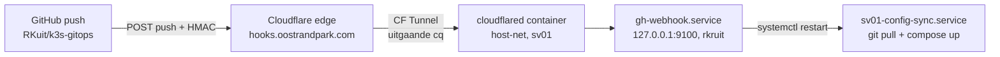

# GitHub push-deploy (webhook)

Push naar `main` → deploy op sv01 **binnen enkele seconden** in plaats van ≤5 min. De webhook is het primaire triggersignaal; de 5-minuten-timer blijft als fallback draaien (mist een webhook, dan vangt de timer het binnen 5 min alsnog op).

## Architectuur

- **cloudflared** (container `sv01-cloudflared`, `network_mode: host`) is de connector van CF-tunnel **sv01-hooks**: alléén uitgaande verbindingen, geen open poorten, geen published ports. Hij bereikt de receiver op localhost:9100 — daarom host-net.
- **Receiver** = host-side systemd-unit `gh-webhook.service` (User=rkruit, script `sv01/scripts/gh_webhook_receiver.py`, stdlib-only). Bindt bewust op `127.0.0.1:9100` — publiek bereikbaar is het endpoint uitsluitend via de tunnel.
- **Deploy-path onveranderd**: de receiver restart `sv01-config-sync.service` (git pull + host-side compose up) — het enige veilige deploy-pad (Komodo mag de volledige stack niet deployen: periphery-recreate-issue). Deploys convergeren altijd naar de laatste commit, ook als er mid-run nog een push binnenkomt (restart = opnieuw pull+up).
- **Timer blijft**, bewust: fallback bij webhook-uitval; 5 min garantie-looptijd.

## Beveiliging

| Laag | Mechanisme |
|---|---|
| Payload | `X-Hub-Signature-256` HMAC-SHA256 met `GH_WEBHOOK_SECRET` (constant-time compare; geen secret in git) |
| Endpoint | `127.0.0.1`-bind; publiek alléén via CF-tunnel |
| Event/branch | alléén `push` + `refs/heads/main`; `ping` → 200; events/branches → genegeerd |
| Trigger | exact één actie: `systemctl restart sv01-config-sync.service` (via rkruit's bestaande sudo) |

## Componenten en paden

| Onderdeel | Waar |
|---|---|
| Receiver-script | `sv01/scripts/gh_webhook_receiver.py` (repo-kopie canonicaal) |
| Receiver-unit | `sv01/systemd/gh-webhook.service` → `/etc/systemd/system/` (bootstrap installeert mee) |
| Tunnel | CF-dashboard **Networking → Tunnels → sv01-hooks** (remote-managed; routes daar) |
| Secrets | `/srv/sv01-secrets/gh-webhook.env` — `GH_WEBHOOK_SECRET` (HMAC) + `TUNNEL_TOKEN` (connector) |

## Zet het op / verplaats het

1. **Tunnel**: dashboard account-kiezer op het domein-account → Networking → Tunnels → Create Tunnel (naam `sv01-hooks`) → install-stap overslaan → tunnel-ID geven aan de agent (die leest het connectortoken via API als het token dat mag of het `eyJ…`-blok uit de wizard in `TUNNEL_TOKEN=` zetten).
2. **Route**: tunnel openen → Routes → Add route → **Tunnel hostname** → subdomain `hooks` + domain `oostrandpark.com` + service `http://localhost:9100` (dashboard maakt de proxied CNAME zelf aan; pas mogelijk zodra de connector Healthy is — de UI houdt de route vast tot de tunnel actief is).
3. **Receiver**: `sudo install -m 644 /opt/sv01-config/sv01/systemd/gh-webhook.service /etc/systemd/system/ && sudo systemctl daemon-reload && sudo systemctl enable --now gh-webhook.service`.
4. **GitHub-webhook**: repo Settings → Webhooks → Add webhook — payload URL `https://hooks.oostrandpark.com/`, JSON, secret = `GH_WEBHOOK_SECRET`, events: alléén *push*. Een `admin:repo_hook`-PAT bestaat niet in deze setup → UI-stap. Bij het aanmaken verstuurt GitHub meteen een *ping*; die moet `ping ok` loggen en een groene ✓ geven.
5. **Test**: een (legen) commit pusht → `journalctl -u gh-webhook -n 5` toont `deploy triggered for refs/heads/main` → sync-unit draait met 2× SUCCES.

## Health/monitoring

- Receiver: `curl http://127.0.0.1:9100/` → 200 `ok` (GET is de healthcheck; Kuma-monitor op de tunnel-URL kan hieraan hangen zodra de route live is).
- Tunnel-status in het dashboard moet **Healthy** zijn (4 verbindingen).

## Pitfalls

- **Route-add weigert op een Inactive tunnel**: opzet is connector-eerst; container live = tunnel Healthy = route-add vrij.
- **Tunnel in het verkeerde account aangemaakt**: de account-switcher heeft meerdere accounts; een tunnel kan geen route op een zone in een ander account. Delete en opnieuw in het domein-account.
- **Geen apt-cloudflared installeren op de host**: de wizard aanbiedt de host-package; wij bewust containerized (git-beheerd, timer-beheerd). Een tweede (package-)cloudflared zou tegen het compose-patroon in gaan.
- **Secret-rotatie**: `GH_WEBHOOK_SECRET` roteren = twee plekken: env-file + GitHub-webhook-instelling, dan `systemctl restart gh-webhook`.
- Deploys met nieuwe images: de webhook doet (zoals de timer) géén `compose pull` — zie [deploy runbook](../runbooks/deploy.md).