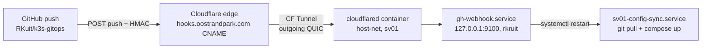

# GitHub push-deploy (webhook)

Push to `main` → deploy on sv01 **within seconds** instead of ≤5 min. The webhook is the primary trigger; the 5-minute timer keeps running as a fallback (if a webhook is missed, the timer catches it within 5 min).

## Architecture

- **cloudflared** (container `sv01-cloudflared`, `network_mode: host`, `user: "0:0"` — the image runs non-root and cannot read the 640 creds file otherwise) is the connector for CF tunnel **sv01-hooks**: outgoing connections only, no open ports, no published ports. It reaches the receiver on localhost:9100 — hence host-net.
- **Ingress in git, not in the CF dashboard**: `sv01/compose/cloudflared/config.yaml` (tunnel id + one line: `hooks.oostrandpark.com → http://localhost:9100` + catch-all 404). The tunnel runs locally-managed on `/srv/sv01-secrets/cloudflared-creds.json` (TunnelSecret, outside git). Dashboard routes are deliberately not the path here: the dashboard refuses route-adds until a connector is connected and manages ingress for remote-managed tunnels only — with the route in git the pattern matches the rest of the stack (git = the only source).
- **Receiver** = host-side systemd unit `gh-webhook.service` (User=rkruit, script `sv01/scripts/gh_webhook_receiver.py`, stdlib-only). Deliberately binds to `127.0.0.1:9100` — the endpoint is publicly reachable only via the tunnel.
- **Deploy path unchanged**: the receiver restarts `sv01-config-sync.service` (git pull + host-side compose up) — the only safe deploy path (Komodo must not deploy the full stack: periphery-recreate issue). Deploys always converge to the latest commit, even if another push arrives mid-run (restart = pull+up again).
- **Timer stays**, deliberately: fallback on webhook loss; 5-minute guaranteed window.

## Security

| Layer | Mechanism |
|---|---|
| Payload | `X-Hub-Signature-256` HMAC-SHA256 with `GH_WEBHOOK_SECRET` (constant-time compare; no secret in git) |
| Endpoint | `127.0.0.1` bind; public only via the CF tunnel |
| Event/branch | only `push` + `refs/heads/main`; `ping` → 200; other events/branches ignored |
| Trigger | exactly one action: `systemctl restart sv01-config-sync.service` (via rkruit's existing sudo) |

## Components and paths

| Component | Where |
|---|---|
| Receiver script | `sv01/scripts/gh_webhook_receiver.py` (repo copy is canonical) |
| Receiver unit | `sv01/systemd/gh-webhook.service` → `/etc/systemd/system/` (bootstrap installs it) |
| cloudflared ingress | `sv01/compose/cloudflared/config.yaml` (git) |
| Tunnel credentials | `/srv/sv01-secrets/cloudflared-creds.json` — `{AccountTag, TunnelID, TunnelSecret}`, outside git |
| DNS | CNAME `hooks.oostrandpark.com → <tunnel-id>.cfargotunnel.com` (proxied) in the CF zone — REQUIRED for GitHub traffic; deliberately no unbound entry in the LAN resolver (LAN loops for hooks go via the CF edge) |
| Secrets | `/srv/sv01-secrets/gh-webhook.env` — `GH_WEBHOOK_SECRET` (HMAC); `TUNNEL_TOKEN` is in there but unused by compose now (source from which the credentials were derived) |
| Tunnel status | CF dashboard **Networking → Tunnels → sv01-hooks** (Healthy: 4 connections) — status/observability only |

## Setup / relocation

1. **Tunnel**: CF dashboard (the right account = the one that owns the `oostrandpark.com` zone) → Networking → Tunnels → Create Tunnel (name `sv01-hooks`) → skip the install step → grab the connector token (`eyJ…`).
2. **Credentials + DNS**: the token derives `{AccountTag, TunnelID, TunnelSecret}` → `cloudflared-creds.json` (640 root:rkruit) + CNAME `hooks → <TunnelID>.cfargotunnel.com` (proxied) via an API token with Zone:DNS:Edit.
3. **Ingress**: `sv01/compose/cloudflared/config.yaml` in git → the sync timer applies `docker compose up -d`; the container registers 4 connections (edge ams*).
4. **Receiver**: `sudo install -m 644 /opt/sv01-config/sv01/systemd/gh-webhook.service /etc/systemd/system/ && sudo systemctl daemon-reload && sudo systemctl enable --now gh-webhook.service`.
5. **GitHub webhook**: repo Settings → Webhooks → Add webhook — payload URL `https://hooks.oostrandpark.com/`, JSON, secret = `GH_WEBHOOK_SECRET`, events: *push* only. No `admin:repo_hook` PAT exists in this setup → UI step. GitHub sends a *ping* on creation; it must log `ping ok` and show a green ✓.
6. **Test**: push an (empty) commit → `journalctl -u gh-webhook -n 5` shows `deploy triggered for refs/heads/main` → sync unit 2× SUCCESS.

## Health/monitoring

- Receiver: `curl http://127.0.0.1:9100/` → 200 `ok` (GET is the healthcheck). Kuma monitor **"GitHub webhook (hooks)"** (id 13, https://hooks.oostrandpark.com/, notification Telegram id 1) watches the entire chain including the CF edge; it is on the public status page in group *Sites*.
- End-to-end without GitHub: a signed HMAC POST to `https://hooks.oostrandpark.com/` → 200 AND `deploy triggered` in journald — proves edge → tunnel → receiver → sync unit.
- Tunnel status in the dashboard must be **Healthy** (4 connections).

## Pitfalls

- **The wizard's route-add refuses on an (still) Inactive tunnel** and the wizard wants remote-managed ingress: hence ingress-locally-in-git (model above). Leave the wizard tunnel behind; the dashboard is status-view only here.
- **Tunnel created in the wrong account**: the account switcher has multiple accounts; a tunnel cannot take a route on a zone in another account. Check via the token decode (`a` field) against the zone owner. Delete and recreate in the domain account.
- **"permission denied" on creds in the container**: the cloudflared image runs non-root — compose `user: "0:0"` or make the creds file world-readable (the former is cleaner).
- **Don't install apt cloudflared on the host**: the wizard offers the host package; we deliberately run containerized (git-managed, timer-managed).
- **No unbound entry for hooks**: LAN resolution of hooks deliberately NOT local — traffic must go via the CF edge (a `hooks → 192.168.1.10` entry would hit Caddy, which has no hooks route).
- **Secret rotation**: rotating `GH_WEBHOOK_SECRET` = two places: env-file + GitHub webhook setting, then `systemctl restart gh-webhook`. Tunnel rotation: new token → re-derive `cloudflared-creds.json` → `docker compose up -d cloudflared`.
- Deploys with new images: the webhook does (like the timer) no `compose pull` — see the [deploy runbook](../runbooks/deploy.md); the daily image-update handles floating tags ([container-upkeep](../services/container-upkeep.md)).