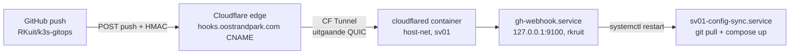

# GitHub push-deploy (webhook)

Push naar `main` → deploy op sv01 **binnen enkele seconden** in plaats van ≤5 min. De webhook is het primaire triggersignaal; de 5-minuten-timer blijft als fallback draaien (mist een webhook, dan vangt de timer het binnen 5 min alsnog op).

## Architectuur

- **cloudflared** (container `sv01-cloudflared`, `network_mode: host`, `user: "0:0"` — het image draait non-root en kan de 640-creds-file anders niet lezen) is de connector van CF-tunnel **sv01-hooks**: alléén uitgaande verbindingen, geen open poorten, geen published ports. Hij bereikt de receiver op localhost:9100 — daarom host-net.
- **Ingress in git, niet in het CF-dashboard**: `sv01/compose/cloudflared/config.yaml` (tunnel-id + één regel: `hooks.oostrandpark.com → http://localhost:9100` + catch-all 404). De tunnel draait lokaal-managed op basis van `/srv/sv01-secrets/cloudflared-creds.json` (TunnelSecret, buiten git). Dashboard-Routes is hier doelbewust niét het pad: die weigert route-add totdat een connector verbonden is en beheert ingress alleen remote-managed — met de route in git is het pattern conform de rest van de stack (git = enige bron).
- **Receiver** = host-side systemd-unit `gh-webhook.service` (User=rkruit, script `sv01/scripts/gh_webhook_receiver.py`, stdlib-only). Bindt bewust op `127.0.0.1:9100` — publiek bereikbaar is het endpoint uitsluitend via de tunnel.
- **Deploy-path onveranderd**: de receiver restart `sv01-config-sync.service` (git pull + host-side compose up) — het enige veilige deploy-pad (Komodo mag de volledige stack niet deployen: periphery-recreate-issue). Deploys convergeren altijd naar de laatste commit, ook als er mid-run nog een push binnenkomt (restart = opnieuw pull+up).
- **Timer blijft**, bewust: fallback bij webhook-uitval; 5 min garantie-looptijd.

## Beveiliging

| Laag | Mechanisme |
|---|---|
| Payload | `X-Hub-Signature-256` HMAC-SHA256 met `GH_WEBHOOK_SECRET` (constant-time compare; geen secret in git) |
| Endpoint | `127.0.0.1`-bind; publiek alléén via CF-tunnel |
| Event/branch | alléén `push` + `refs/heads/main`; `ping` → 200; overige events/branches → genegeerd |
| Trigger | exact één actie: `systemctl restart sv01-config-sync.service` (via rkruit's bestaande sudo) |

## Componenten en paden

| Onderdeel | Waar |
|---|---|
| Receiver-script | `sv01/scripts/gh_webhook_receiver.py` (repo-kopie canonicaal) |
| Receiver-unit | `sv01/systemd/gh-webhook.service` → `/etc/systemd/system/` (bootstrap installeert mee) |
| cloudflared ingress | `sv01/compose/cloudflared/config.yaml` (git) |
| Tunnel-credentials | `/srv/sv01-secrets/cloudflared-creds.json` — `{AccountTag, TunnelID, TunnelSecret}`, buiten git |
| DNS | CNAME `hooks.oostrandpark.com → <tunnel-id>.cfargotunnel.com` (proxied) in de CF-zone — NODIG voor GitHub-verkeer; bewust géén unbound-entry in de LAN-resolver (LAN-loops voor hooks lopen via CF-edge) |
| Secrets | `/srv/sv01-secrets/gh-webhook.env` — `GH_WEBHOOK_SECRET` (HMAC); `TUNNEL_TOKEN` zit erin maar wordt door compose niet meer gebruikt (bron voor de credentials-afleiding) |
| Tunnel-status | CF-dashboard **Networking → Tunnels → sv01-hooks** (Healthy: 4 verbindingen) — alleen status/observability |

## Zet het op / verplaats het

1. **Tunnel**: CF-dashboard (juiste account = degene die de zone `oostrandpark.com` bezit) → Networking → Tunnels → Create Tunnel (naam `sv01-hooks`) → install-stap overslaan → connectortoken (`eyJ…`) pakken.
2. **Credentials + DNS**: uit het token valt `{AccountTag, TunnelID, TunnelSecret}` af te leiden → `cloudflared-creds.json` (640 root:rkruit) + CNAME `hooks → <TunnelID>.cfargotunnel.com` (proxied) via een API-token met Zone:DNS:Edit.
3. **Ingress**: `sv01/compose/cloudflared/config.yaml` in git → sync-timer past `docker compose up -d` toe; de container registreert 4 verbindingen (edge ams*).
4. **Receiver**: `sudo install -m 644 /opt/sv01-config/sv01/systemd/gh-webhook.service /etc/systemd/system/ && sudo systemctl daemon-reload && sudo systemctl enable --now gh-webhook.service`.
5. **GitHub-webhook**: repo Settings → Webhooks → Add webhook — payload URL `https://hooks.oostrandpark.com/`, JSON, secret = `GH_WEBHOOK_SECRET`, events: alléén *push*. Een `admin:repo_hook`-PAT bestaat niet in deze setup → UI-stap. Bij het aanmaken verstuurt GitHub meteen een *ping*; die moet `ping ok` loggen en een groene ✓ geven.
6. **Test**: een (legen) commit pusht → `journalctl -u gh-webhook -n 5` toont `deploy triggered for refs/heads/main` → sync-unit 2× SUCCES.

## Health/monitoring

- Receiver: `curl http://127.0.0.1:9100/` → 200 `ok` (GET is de healthcheck). Kuma-monitor **"GitHub webhook (hooks)"** (id 13, https://hooks.oostrandpark.com/, notificatie Telegram id 1) bewaakt de volledige keten inclusief CF-edge, op de publieke statuspage in groep *Sites*.
- End-to-end zonder GitHub: een gesigneerde HMAC-POST naar `https://hooks.oostrandpark.com/` → 200 én `deploy triggered` in journald — bewijst edge → tunnel → receiver → sync-unit.
- Tunnel-status in het dashboard moet **Healthy** zijn (4 verbindingen).

## Pitfalls

- **Wizard-route-add weigert op een (nog) Inactive tunnel** en de wizard wil remote-managed ingress: daarom ingress-lokaal-in-git (bovenstaand model). De wizard-tunnel laat je staan; het dashboard is hier alleen status-bekijk.
- **Tunnel in het verkeerde account aangemaakt**: de account-switcher heeft meerdere accounts; een tunnel kan geen route op een zone in een ander account. Check met de token-decode (`a`-veld) tegen de zone-owner. Delete en opnieuw in het domein-account.
- **"permission denied" op creds in de container**: het cloudflared-image draait non-root — compose `user: "0:0"` of de creds-file world-readable maken (eerste is netter).
- **Geen apt-cloudflared installeren op de host**: de wizard aanbiedt de host-package; wij bewust containerized (git-beheerd, timer-beheerd).
- **Geen unbound-entry voor hooks**: LAN-resolutie van hooks bewust NIET lokaal — het verkeer moet via de CF-edge lopen (een `hooks → 192.168.1.10`-entry zou Caddy raken, die géén hooks-route heeft).
- **Secret-rotatie**: `GH_WEBHOOK_SECRET` roteren = twee plekken: env-file + GitHub-webhook-instelling, dan `systemctl restart gh-webhook`. Tunnel-rotatie: nieuw token → `cloudflared-creds.json` opnieuw afleiden → `docker compose up -d cloudflared`.
- Deploys met nieuwe images: de webhook doet (zoals de timer) géén `compose pull` — zie [deploy runbook](../runbooks/deploy.md).